# 엔진글리시 (Engineglish) — 시동 걸면 영어 엔진도 ON

> **도로가 한산하면 짧게 묻고, 교차로·방향지시등·급제동 앞에서는 바로 입을 다물고, 여유가 생기면 "아까 그 문제 다시 할게요."로 이어 갑니다.**
> 하루 70~80분 출퇴근 운전을 영어 시간으로 바꾸는 Pleos Connect(AAOS) 앱. 학습 기록은 이 차 안에만 암호화해 저장하고, 어떤 서버로도 보내지 않습니다.

현대자동차그룹 차량용 앱 개발 공모전(2026) 출품작 · Pleos Connect (Android Automotive OS 14) 전용 · v2.0.0 (versionCode 3)

**팀 카튜터 (CarTutor) — 차 안의 선생님** · 운전 부하에 맞춰 바뀌는 차량 전용 영어 코치 · release APK: `apk/CarTutor_Engineglish_release.apk`

---

## 실제 구동 화면

Pleos Connect 에뮬레이터에서 실제로 실행한 화면입니다(왼쪽은 에뮬레이터의 차량 상태 영역, 오른쪽이 앱). 주행은 앱 안의 통근 시뮬레이터로 재생했고, 학습 기록 수치는 시연용 가상 기록(`en_seed`)입니다.

| 홈 — 오늘의 세션·복습·진행률 | 주행 학습 — 질문과 앞유리 HUD 힌트 |
|---|---|
| 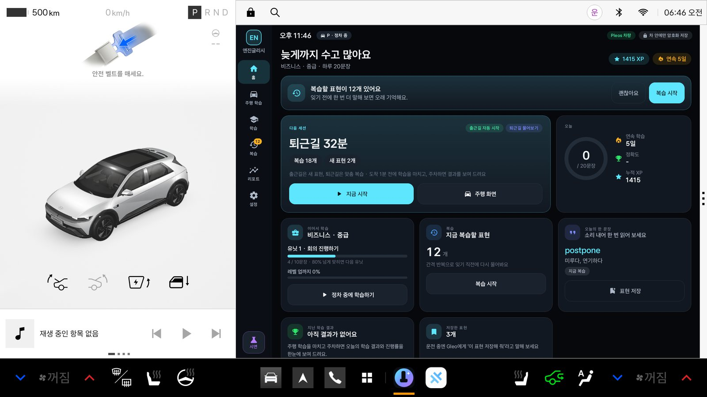 | 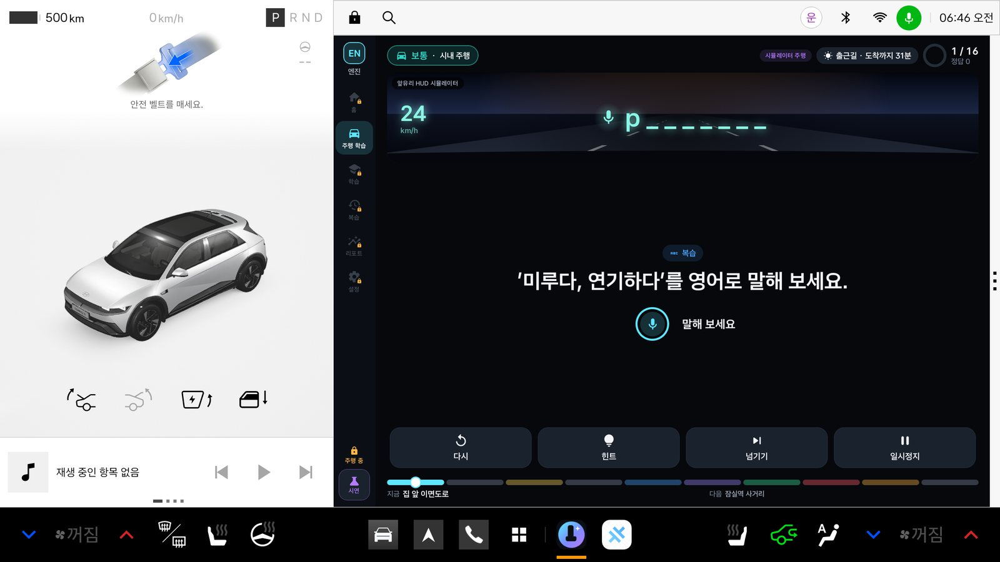 |

| 정답 — 효과음과 XP | 집중 필요 — 방향지시등을 켜면 질문을 멈춤 |
|---|---|
| 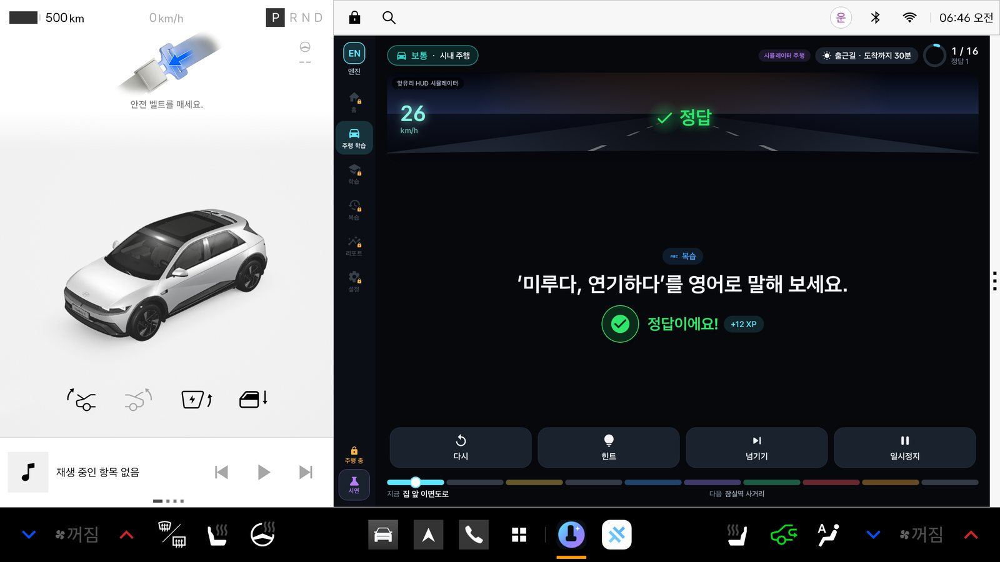 | 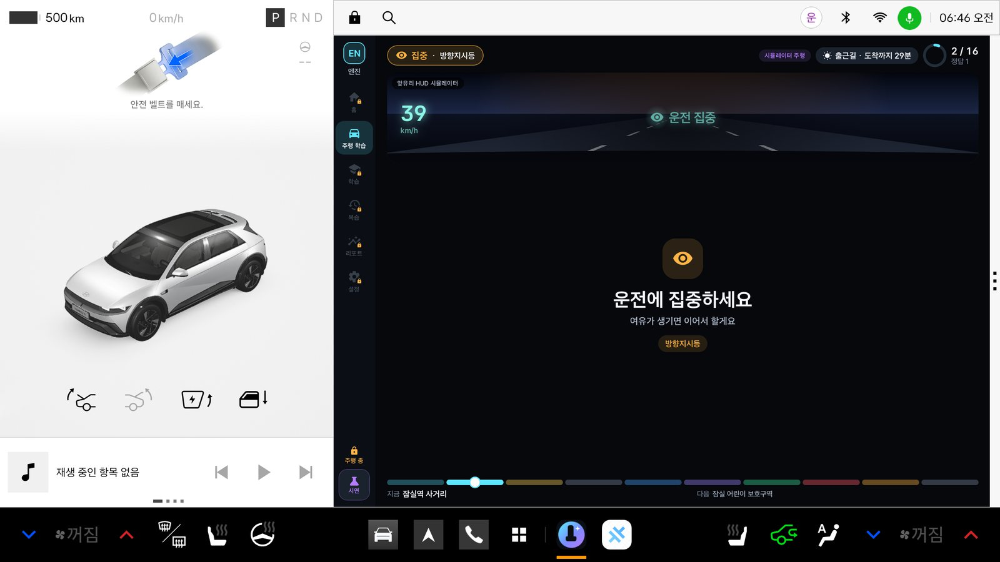 |

| 여유 — 크루즈 주행 중 말하기 | 위험 — 급제동 시 즉시 무음 |
|---|---|
| 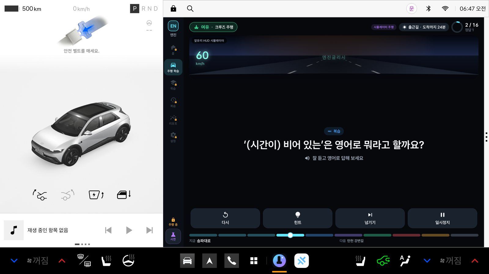 | 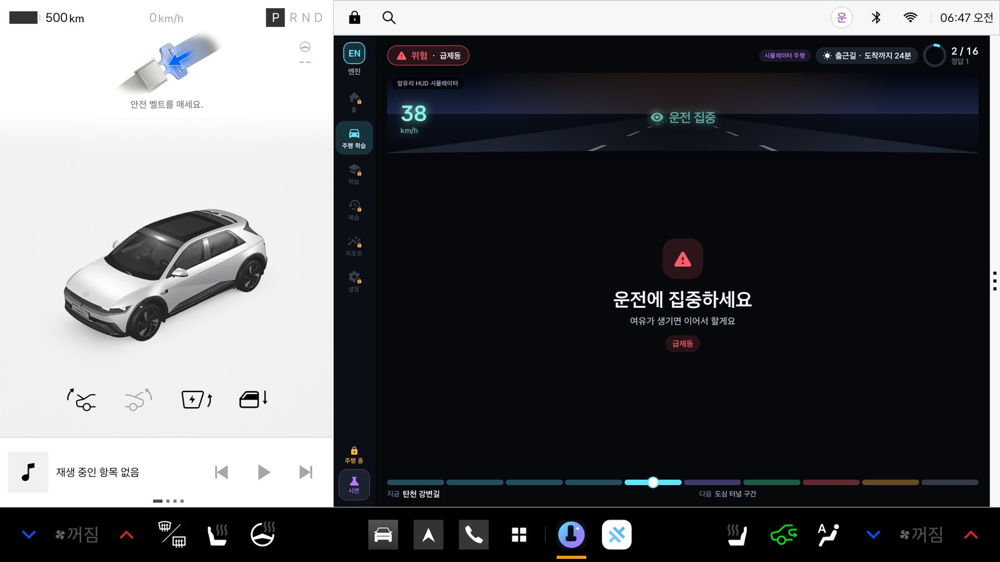 |

| 퇴근길 — 학습할지 먼저 묻기 | 주차 완료(P) 대시보드 — 결과·진행률·마스코트 |
|---|---|
| 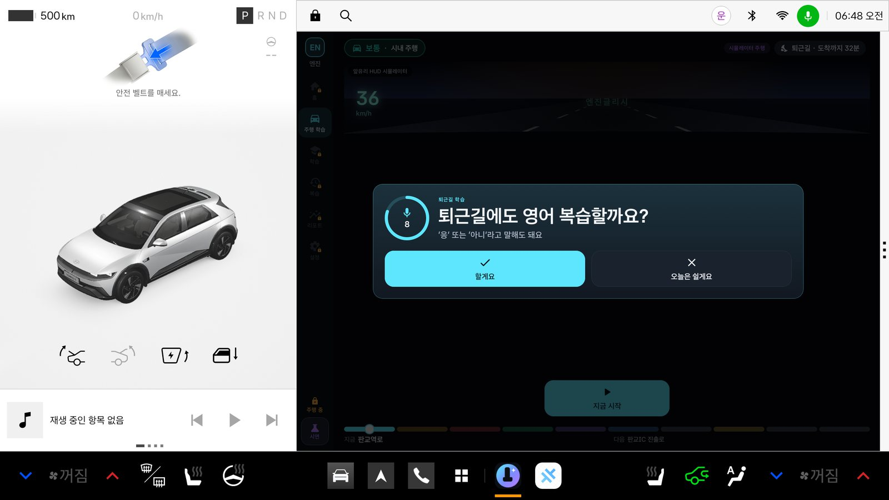 | 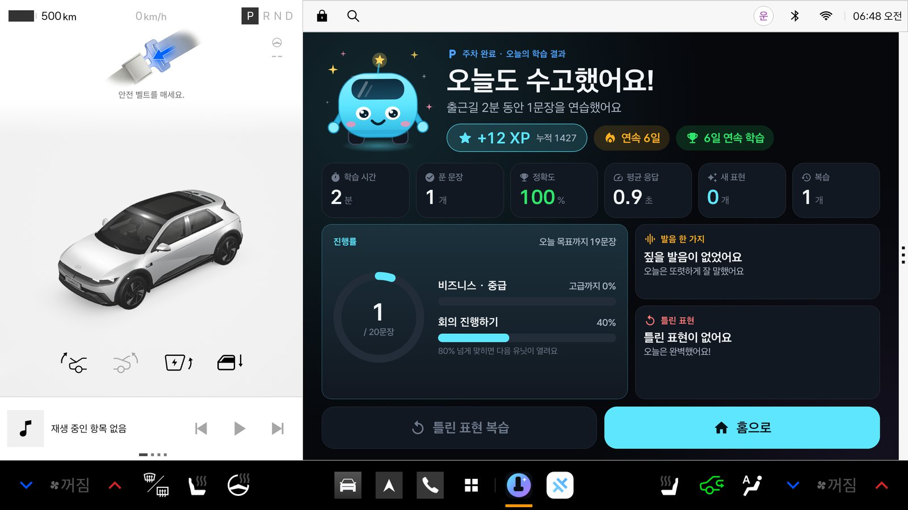 |

| 학습 — 트랙·레벨·유닛 | 리포트 — 주간 기록·발음 프로필 |
|---|---|
| 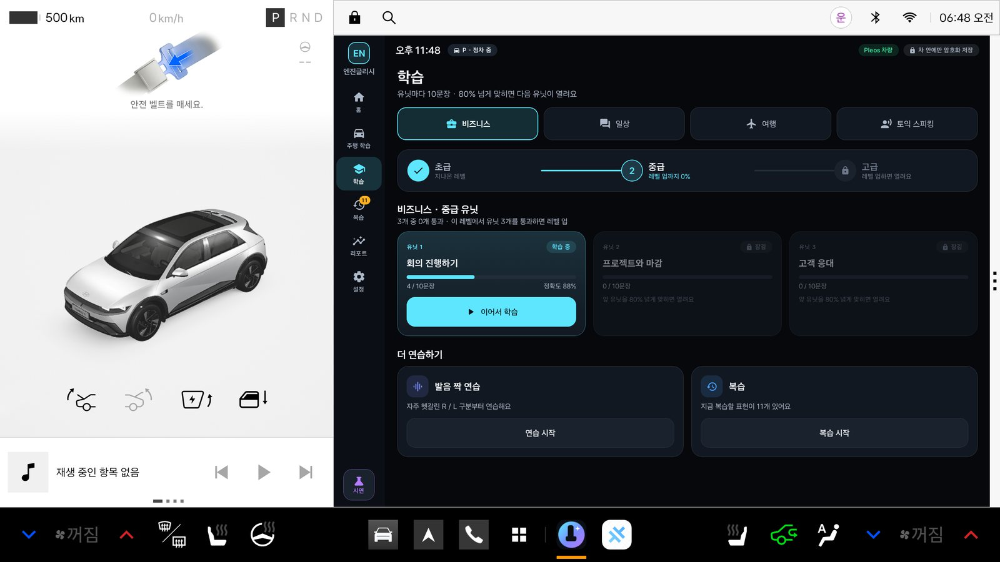 | 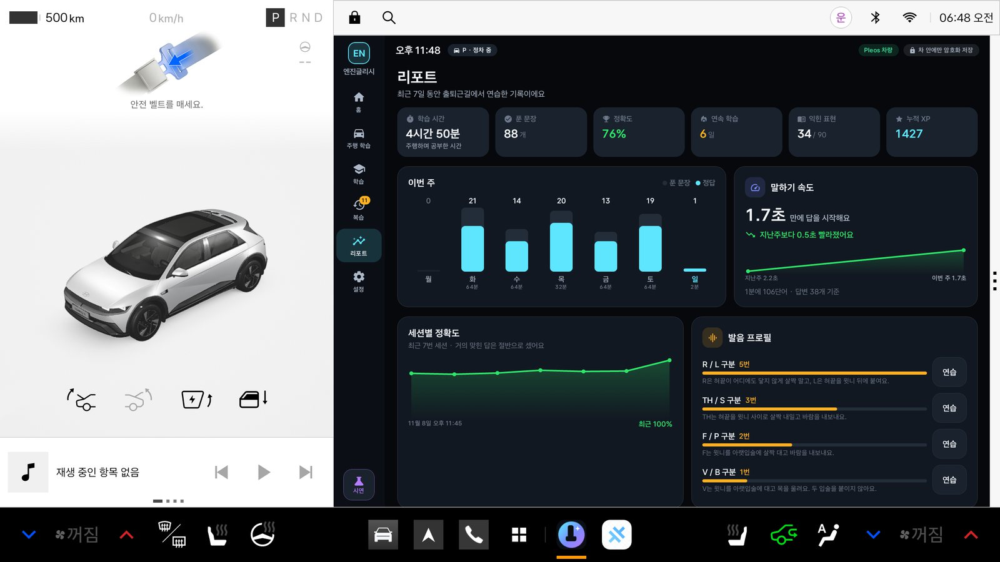 |

| 복습 — 간격 반복 | 설정 — 출퇴근 맞춤·효과음·마이크 테스트 |
|---|---|
| 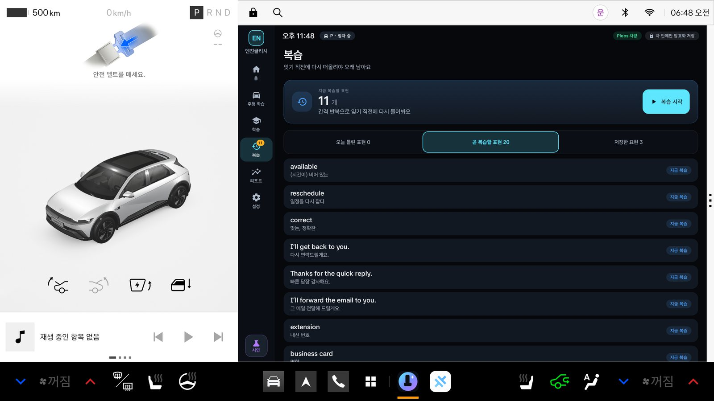 | 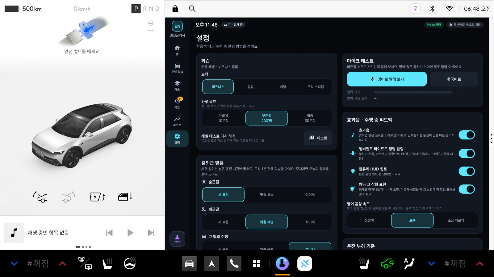 |

첫 실행 화면: 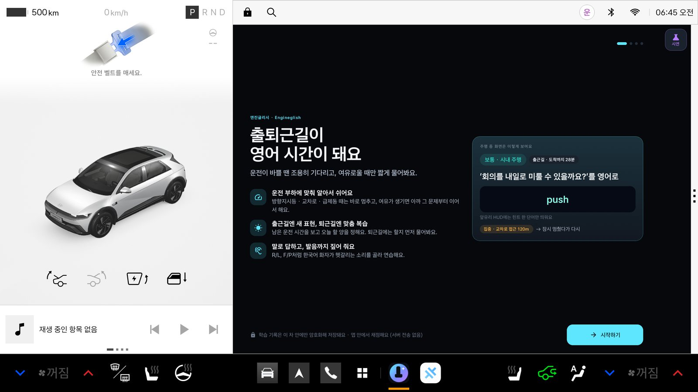

---

## 1. 문제와 해법

| | |
|---|---|
| 문제 | 바쁜 직장인은 하루 70~80분을 운전하지만 휴대폰 학습 앱은 쓸 수 없다. 블루투스 오디오 강의는 운전자가 지금 바쁜지 모른다. |
| 해법 | 차량 신호(기어·속도·제한 속도·내비 안내 지점·방향지시등·핸들·브레이크·크루즈·와이퍼·전조등·내비 음성·충전)로 **운전 부하를 실시간 5단계로 판단**하고, 단계마다 할 수 있는 학습만 한다. |
| 핵심 가치 | 학습 콘텐츠(4개 트랙 × 3레벨, 482문항) + 커리큘럼(레벨 테스트·유닛 체크포인트·간격 반복) + 운전 부하 엔진. 채점은 **앱 안 규칙 엔진**이 한다. |

**AI에 대해**: 답 채점·명령 인식·발음 진단은 모두 앱 안의 규칙 엔진입니다. 학습자 응답 이해 LoRA(Qwen3-4B / 1.7B)는 별도로 학습·평가만 했고(`docs/eval/en_lora_eval.md`) **앱에는 넣지 않았습니다.** 앱은 모델이 돈다고 표시하지 않습니다.

## 2. 기능

### 2-1. 운전 부하 엔진 (`english/drive/RuleLoadEngine.kt`, `TableLoadPolicy.kt`)
| 단계 | 언제 | 앱이 하는 일 |
|---|---|---|
| 정차 PARKED | P단, 충전 중 정차 | 전체 화면 학습 — 레벨 테스트, 화면 보기 문제, 복습, 리포트, 주차 대시보드 |
| 여유 RELAXED | 크루즈 주행, 15초 넘게 이어진 고속 직진 | 토익 스피킹(최대 45초 답변) + 아래 모두 |
| 보통 NORMAL | 시내 주행, 정체(가다 서다) | 듣고 따라 말하기, 한→영 문장 만들기(12단어 이하), 단어 떠올리기 |
| 집중 FOCUS | 방향지시등, 교차로·나들목 300m(또는 8초) 이내, 큰 핸들 조작, 단속 카메라 200m, 어린이 보호구역, 야간 빗길 | 새 질문 없음, 듣기 중단, 2초 안에 끝나는 말만 마무리 |
| 위험 CRITICAL | 급제동(−3.5m/s² 이하), 제한 속도 +10km/h 초과, 내비 음성 안내 중 | 말하기·듣기 즉시 정지 |

- 올라갈 때는 즉시, 내려갈 때는 낮은 단계가 4초 안정돼야 내려간다(위험은 원인이 사라져도 3초 유지 후 집중을 거친다).
- 끊긴 문제는 **틀린 걸로 치지 않고**, 부하가 내려가면 "아까 그 문제 다시 할게요."로 같은 문제를 다시 묻는다.
- 화면에는 이유를 한국어로 보여 준다: "교차로 접근 120m", "방향지시등", "급제동", "내비 음성 안내 중".

### 2-2. 커리큘럼 (`assets/content/*.json`, `english/learn/**`)
- 트랙: 비즈니스 · 일상 · 여행 · 토익 스피킹 / 레벨: 초급 · 중급 · 고급 / 유닛 10문항 × 3유닛 × 3레벨 × 4트랙 = 360문항 + 상황 표현 38 + 발음 드릴 48 + 오늘의 한 문장 36.
- 문항 종류: 단어 떠올리기(한→영), 표현·문장 만들기(정답 여러 개 허용), 듣고 따라 말하기, 토익 스피킹(핵심어·길이·문법 휴리스틱 채점), 발음 짝 단어(R/L 등).
- 첫 실행: 트랙·하루 목표 선택 → 적응형 레벨 테스트 12문항(맞히면 어려워지고 틀리면 쉬워짐) → 시작 레벨.
- 유닛 평균 80% 이상이면 다음 유닛이 열리고, 레벨의 유닛을 통과하면 레벨 업. XP · 연속 학습일 · 하루 목표.
- 간격 반복(SM-2 계열): 다시/어려움/좋음/쉬움 — 1.5초 안에 바로 맞히면 '쉬움'.

### 2-3. 출퇴근 맞춤 (`CommuteSessionPlanner`, `RouteCommuteDetector`)
- 집→회사 = 출근길(기본: 새 표현), 회사→집 = 퇴근길(기본: 오늘 틀린 표현 + 복습 예정 카드). 설정에서 시간대별로 바꿀 수 있다.
- 남은 운전 시간으로 분량을 정한다: "출근길 32분 → 새 표현 6개 + 복습 10개".
- **도착 1분 전에는 학습을 끝낸다.** 묻던 문제는 접고(틀린 걸로 치지 않는다) "곧 도착해요. 오늘 학습은 여기까지 할게요." 한마디만 하고, 주차할 때까지 더 묻지 않는다.
- 출근길은 출발하면 자동 시작(설정). **퇴근길은 먼저 묻는다** — "퇴근길에도 영어 복습할까요?"
  - 말로 답하거나("응", "네", "좋아", "할게", "yes", "sure", "okay" / "아니", "괜찮아", "쉴게", "다음에", "no", "not today") 화면의 큰 버튼 두 개(할게요 / 오늘은 쉴게요)를 누른다.
  - 10초 안에 답이 없거나 운전이 바빠지면(집중 이상) 질문을 거두고, 여유가 생겼을 때 한 번만 다시 묻는다. 그래도 답이 없으면 조용히 넘어간다.
  - 설정 '퇴근길 학습': 물어보기(기본) · 항상 시작 · 안 함.
- 출발 시각을 배워 출근 15분 전 제안.

### 2-4. 손을 쓰지 않는 말하기와 발음 피드백 (`english/speech/**`)
- 한국어 안내와 영어 문장은 Pleos TTS(영어가 안 되면 Android TTS en-US), 답은 Pleos STT(en-US)로 받는다.
- 정규화(대소문자·문장부호·축약형·숫자·군말 um/uh/like) → 여러 정답 중 가장 가까운 것과 단어 정렬 → 정답/부분 정답/오답/무응답 + 점수.
- 한국어 화자 발음 혼동 8종(R/L, F/P, V/B, TH/S, TH/D, Z/J, SH/S, 끝소리 탈락)을 단어 대체에서 찾아 한국어 팁과 짝 단어 드릴을 준다.
- 유창성: 답을 시작하기까지 걸린 시간, 말한 시간, 분당 단어 수, 쉼.
- 음성 명령(영·한): repeat/다시, slower/천천히, skip/넘겨, hint/힌트, meaning/뜻, pause/잠깐, continue/계속, 모르겠어요, 그만.

### 2-5. 차라서 할 수 있는 것
- **주차 대시보드**: 주행 학습을 마치고 P단에 넣으면 전체 화면으로 오늘 결과(학습 시간 · 답한 문장 · 정확도 · 평균 응답 시간 · 새 표현 · 복습 · 발음 약점과 예시)와 진행률(레벨·유닛 막대, 오늘 목표 링, 연속 학습일, XP)을 보여 준다. 마스코트가 완료 징글과 함께 "오늘도 수고했어요!" 하고 축하한다. '틀린 표현 복습' · '홈으로', 홈의 '지난 학습 결과'에서 다시 볼 수 있다.
- **효과음**: 정답이면 밝은 마림바 아르페지오, 거의 맞으면 부드러운 음, 틀리면 낮고 순한 음. 연속 정답 5개 · 레벨 업 · 학습 완료는 짧은 팡파르. 모두 직접 합성한 소리(`tools/gen_sounds.py` → `res/raw/sfx_*.wav`)이고, 오디오 포커스를 잡지 않아 안내 음성을 끊지 않는다. 운전 부하가 '위험'이면 울리지 않는다. 설정 '효과음'으로 끌 수 있다.
- **방금 그 상황 표현**: 정체를 빠져나오면 "I was stuck in traffic.", 와이퍼가 켜지면 "It's pouring.", 터널·어린이 보호구역·회사 도착·충전·공항 목적지(여행 트랙 제안).
- **핸들 미디어 버튼**: 다음 = 넘기기, 이전 = 다시, 재생/일시정지 = 잠깐/계속 (Activity 키 이벤트 + MediaSession).
- **앞유리 HUD 힌트**: 듣는 동안 힌트 한 단어만(단어 문제는 첫 글자만 "r _ _ _ _"). 정답/아쉬움은 1초 앰비언트 라이트 색(초록/주황) + 화면 가장자리 빛.

### 2-6. 안전·차량 UX
- 주행 중(CarUxRestrictions)에는 '주행 학습' 화면만 조작할 수 있고, 다른 화면은 "정차 후 이용할 수 있어요".
- 주행 화면 문제 글자 34sp 이상, 버튼 76dp 이상·최대 4개, 스크롤·목록 없음, 영어 문장은 귀로만(정차 중에만 화면에 표시).

### 2-7. Gleo App Schema (`assets/schema.json`, `platform/gleo/GleoBridge.kt`)
| 함수 | component | 동작 |
|---|---|---|
| `START_ENGLISH_SESSION(track?)` | activity | 운전 부하에 맞춘 세션 시작 (business · daily · travel · toeic_speaking) |
| `REVIEW_NOW()` | activity | 지금 복습할 표현(오늘 틀린 것부터) |
| `SAVE_EXPRESSION(text?)` | service | 지금 문장(또는 말한 문장)을 차 안 표현 노트에 저장 |

## 3. 개인정보
- 학습 기록(진도·복습 카드·발음 기록·출발 시각(분))은 `english_learner_v1.bin` 한 파일에 **AES-256-GCM(Android Keystore 키)**으로 암호화해 이 차 안에만 저장한다. 서버 전송 없음, 목소리 녹음·위치 좌표 저장 없음.
- 로그에는 오류 코드만 남긴다(발화·답·위치·장소 이름은 남기지 않음). 설정 → "학습 기록 모두 지우기".
- 지도는 **가상 출퇴근 지도 "잠실 ↔ 판교"**(공공 랜드마크, 좌표 소수점 3자리)만 쓴다. 학습자는 가상 인물이며 실명·연락처·주소가 없다.
- 이전 버전(장소 이름 보정)의 개인 장소·방문 기록 파일은 앱이 시작될 때 지운다(지도 정보 초기화).

## 4. 사용 SDK와 권한
- Pleos SDK: **Vehicle 2.3.2 · NaviHelper 3.0.5 · SpeechToText 3.3.1 · TextToSpeech 3.3.1 · FusedLocation 1.1.3** + 표준 AAOS/Android API(CarUxRestrictions, CarPropertyManager 차속, AudioManager 포커스·재생 콜백, MediaSession). `@PrivilegedApi`·내부 API는 쓰지 않는다.
- 차량 마이크는 SpeechToText SDK로만 받는다(`RECORD_AUDIO`·AudioRecord·SpeechRecognizer 없음). 외부 지도 API 없음.
- 권한: `CAR_SPEED`(런타임) · Pleos `CAR_DRIVE`(기어·핸들·브레이크·크루즈) · `CAR_LIGHTS`(방향지시등·전조등) · `CONTROL_CAR_LIGHTS`(앰비언트 펄스) · `CAR_WINDOWS`(와이퍼) · `CAR_ENERGY`(충전) · `NAVI_ROUTE` · `NAVI_ROUTE_SEARCH`(설정에서 켤 때만 시뮬레이터 경로를 실차 내비에 반영, 기본 꺼짐) · `STT_SERVICE` · `TTS_SERVICE` · `FUSED_LOCATION`(런타임). `INTERNET`은 앱이 선언하지 않는다(Pleos STT/TTS SDK가 자체 선언).

## 5. 구조
```
english/core     계약(인터페이스) · 모델 · UI 상태 · 임계값 · MiniJson
english/content  JSON 콘텐츠 로더 · 검증(ContentAudit) · 오늘의 한 문장
english/learn    SRS · 적응형 레벨 테스트 · 진도/체크포인트 · 출퇴근 세션 계획 · 암호화 저장소
english/speech   정규화 · 규칙 채점 · 명령 · 발음 진단 · 유창성 · Pleos STT/TTS 포트 · 오디오 환경 · 마이크 테스트
english/drive    부하 엔진 · 정책 · 상황 훅 · 출퇴근 판단 · 가상 지도 · 신호 허브 · 미디어 키 · 앰비언트
english/coach    DefaultEnglishCoach — 세션 상태 기계(브리핑 → 질문 → 듣기 → 채점 → 피드백, 잠시 멈춤/일시정지/요약) · 퇴근길 질문 · 주차 대시보드
english/sound    효과음 (SoundPool, 직접 합성한 WAV)
ui/english       Compose 화면(홈 · 주행 학습 · 학습 · 복습 · 리포트 · 설정 · 주차 대시보드 · 온보딩 · 레벨 테스트 · 시연 패널)
sim              CommuteSimulator — 출근·퇴근·충전·정차 시나리오, 시연 신호 주입
platform         Pleos 게이트웨이 · SecureVault · Gleo 브리지
```
설계 문서: `docs/ENGLISH_APP_SPEC.md`.

## 6. 빌드 · 테스트
요구 사항: JDK 17~21, Android SDK Platform 36, Gradle 8.14.3(wrapper).
```bash
./gradlew :app:assembleDebug        # 디버그 APK
./gradlew :app:testDebugUnitTest    # 단위 테스트 356개 (콘텐츠 11 · 코어 17 · 학습 73 · 말하기 116 · 운전 78 · 코치 61)
```
Pleos SDK는 `settings.gradle.kts`의 Pleos Maven 저장소에서 받는다.

## 7. 시연 (디버그 빌드 또는 ADB 켜짐일 때만 동작)
화면 왼쪽 아래 **시연** 버튼으로 시연 패널(시나리오 · 운전 신호 · 답 주입 · 음성 명령 · 미디어 키 · 배속)을 연다. adb로도 같은 일을 할 수 있다(에뮬레이터 지정 필수):
```bash
A="adb -s emulator-5554 shell am start -n com.cartutor.engineglish/.MainActivity"
$A --ez en_seed true                      # 가상 학습 기록(6일 연속·복습 카드·틀린 표현) 채우기
$A --es en_scenario MORNING               # MORNING | EVENING | CHARGING | PARKED | STOP  (EVENING: 3초 달린 뒤 "퇴근길에도 영어 복습할까요?")
$A --es signal TURN_ON                    # TURN_ON | TURN_OFF | INTERSECTION | HARD_BRAKE | RAIN_ON | RAIN_OFF | JAM | CRUISE_ON | CRUISE_OFF | NAV_PROMPT | NEAR_ARRIVAL | ARRIVE | TUNNEL | SCHOOL_ZONE ...
$A --es hear "Can we push the meeting to tomorrow?"   # STT 결과와 같은 길로 답 넣기 (퇴근길 질문에는 "응 할게" · "not today")
$A --es answer CORRECT                    # CORRECT | PARTIAL | WRONG | L1_ERROR | DONT_KNOW (지금 문항 기준)
$A --es key NEXT                          # NEXT | PREVIOUS | PLAY_PAUSE (핸들 버튼과 같은 길)
$A --es screen REPORT                     # HOME | DRIVE | LESSON | REVIEW | REPORT | SETTINGS
$A --es timescale 6 | --ez en_reset true
```
Gleo 재현: `adb -s emulator-5554 shell "am start -a START_ENGLISH_SESSION -n com.cartutor.engineglish/.MainActivity --es ACTION_PARAM '{\"track\":\"travel\"}'"`,
`adb -s emulator-5554 shell "am broadcast -a SAVE_EXPRESSION -n com.cartutor.engineglish/.platform.gleo.GleoActionReceiver --es ACTION_PARAM '{\"text\":\"Let us call it a day.\"}'"`.

권장 발표 흐름: `en_seed` → MORNING(브리핑 "출근길 32분 → 새 표현 6개 + 복습 10개") → 정답 주입(초록 펄스) → TURN_ON(잠시 멈춤 "방향지시등") → TURN_OFF("아까 그 문제 다시 할게요") → 터널 상황 표현 → CRUISE_ON(여유, 토익 질문) → HARD_BRAKE(즉시 정지) → L1_ERROR(발음 피드백) → JAM → 정체 탈출 표현 → NEAR_ARRIVAL(도착 1분 전으로, 배속 2배로 낮춤 → "곧 도착해요. 오늘 학습은 여기까지 할게요.") → 도착 · P단 → 주차 대시보드(마스코트 · 완료 징글) → 틀린 표현 복습 → 리포트. 퇴근길: EVENING → "퇴근길에도 영어 복습할까요?" → "응"이라고 말하거나 '할게요'.

### 직접 말해서 시험하기 (에뮬레이터 마이크)
에뮬레이터는 PC에 마이크가 꽂혀 있어도 기본으로는 그 소리를 앱에 넘기지 않는다. 말로 답해 보려면:
1. **에뮬레이터를 켤 때마다** `adb -s emulator-5554 emu avd hostmicon` 을 실행한다. (화면으로는 에뮬레이터 도구 막대 `⋯` → Microphone → "Virtual microphone uses host audio input". 껐다 켜면 다시 꺼지니 녹화 직전에 한 번 더 확인한다.)
2. PC 운영체제에서 마이크 접근을 허용한다 (Windows: 설정 → 개인 정보 → 마이크 → 데스크톱 앱 허용).
3. 이어폰을 낀다. 에뮬레이터는 에코 제거가 없어 스피커로 들으면 안내 음성이 다시 마이크로 들어간다.

이 앱은 `RECORD_AUDIO` 권한이 없다. 마이크 소리는 Pleos 음성 인식 서비스가 받고 앱에는 받아 적은 글자만 온다(`STT_SERVICE`). 켜졌는지는 **설정 → 마이크 테스트**로 확인한다: "영어로 말해 보기"(또는 "한국어로")를 누르고 6초 안에 말하면 입력 크기 막대가 움직이고 받아 적은 글자와 결과("잘 들려요. 말로 답할 수 있어요.")가 나온다. 주행 학습 중에도 듣는 동안 받아 적는 글자가 화면에 보인다. `adb -s emulator-5554 logcat -s EngineglishSpeech EngineglishSound` 로는 인식 시작(`stt request locale=en-US`) · 결과 글자 수 · 오류 코드 · 효과음(`cue CORRECT played`)을 볼 수 있다(말한 내용은 남기지 않는다). 아무것도 안 뜨면 1·2번 설정(또는 에뮬레이터 안 Pleos 음성 인식 서비스의 마이크 권한)이 꺼져 있는 것이고, 그동안에도 시연 패널과 `--es hear "…"` 로는 계속 답할 수 있다. 퇴근길 질문은 한국어로 듣는다("응", "네", "할게" / "아니", "쉴게").

## 8. 알려진 한계
- Pleos Connect 에뮬레이터(음성 서비스 4.2.10)에서는 Pleos STT가 en-US를 받아들이고 PC 마이크로 말한 영어를 받아 적는 것을 확인했다. 다만 에코 제거·잡음 제거가 꺼져 있어(스피커 소리·주변 말소리도 답으로 듣는다) 이어폰을 쓰고 조용한 곳에서 시험한다. 영어를 거절하는 환경(`UNAVAILABLE_LANGUAGE`)에서는 로그에 남기고 화면 선택지 · 답 주입(`hear` · `answer` · 시연 패널)으로 계속 쓸 수 있다.
- 에뮬레이터는 PC 마이크를 기본으로 막아 둔다 → 부팅할 때마다 `adb -s emulator-5554 emu avd hostmicon` (7장 '직접 말해서 시험하기').
- 주차 대시보드는 부하 엔진이 '정차'로 내려온 뒤(P단에 넣고 약 4초)에 뜬다. 앱을 다시 켜면 '지난 학습 결과'는 다음 세션을 마칠 때까지 비어 있다.
- 핸들 각도 부호, 앰비언트 색 형식(0xRRGGBB), 핸들 미디어 버튼의 MediaSession 전달은 실차에서 다시 확인해야 한다.
- 학습자 응답 이해 LoRA는 합성 데이터로만 평가했고 앱에 넣지 않았다.
